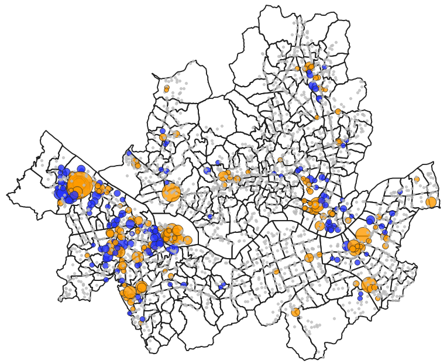
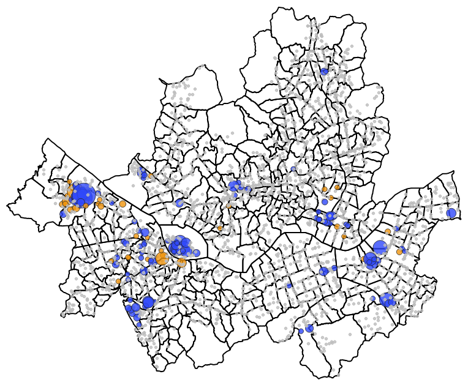

# 🚲 서울시 따릉이 대여소 수급 불균형 분석 및 SQL 성능 개선

> 2025년 서울시 따릉이 대여소 간 이동 데이터 **69,349,606행**을 MySQL에 적재하고,
> 출퇴근 시간대 대여소별 수급 불균형을 분석한 뒤, 대용량 집계 쿼리의 성능을 실행계획 기반으로 개선한 프로젝트

## 프로젝트 요약

| 구분 | 수행 내용 | 결과 |
|---|---|---|
| 대용량 적재 | 일별 CSV 365개를 Python + `LOAD DATA`로 일괄 적재 | **69,349,606행**, 파일당 1\~3초 |
| 적재 오류 해결 | 월별 건수 검증으로 적재 누락 발견 → 파일별 줄바꿈 형식 차이를 원인으로 확인하고 수정 | 1,910,990행 → **69,349,606행** |
| 쿼리 성능 개선 | 실행계획으로 전체 스캔 2회를 확인하고 커버링 인덱스 설계·적용 | 119.4초 → **46.9초 (61% 단축)** |
| 반복 조회 최적화 | 반복 사용하는 집계 결과를 요약 테이블로 저장 | 조회 **0.000초** |
| 분석 | 출근 시간 쏠림이 퇴근 시간에 되돌아가는 비율 비교 | 업무지구 71\~90%, 주거지 42\~62% → **주거지 우선 보충** 제안 |

**사용 기술**: MySQL 8.0 · MySQL Workbench · Python 3 (pymysql, pandas)

## 1. 프로젝트 개요

### 배경
따릉이는 출퇴근 시간에 이용이 한쪽 방향으로 몰린다.
출근 시간에는 주거지 대여소의 자전거가 빠르게 소진되고, 지하철역·업무지구 대여소에는 수십 대가 한꺼번에 쌓인다.
2026년에도 이 쏠림 현상은 따릉이 운영의 주요 과제로 꼽히며, 사람이 차량으로 자전거를 옮기는 재배치 방식은
인력과 운송비가 계속 드는 한계가 있어 이용 데이터를 활용해 부족·과잉을 미리 예측하는 운영이 대안으로 제시되고 있다.[^1]
서울시는 2023년부터 시민 참여 재배치 사업을 운영하고 있으며, 2024년에는 불균형이 심한 지역으로
강서구 마곡, 성동구 성수, 여의도를 지목했다.[^2]

이 프로젝트는 2025년 1년치 이동 데이터로 출퇴근 시간대 대여소별 자전거 쏠림을 분석해, 재배치가 필요한 대여소를 데이터로 찾고자 한다.
또한 1년치 데이터는 수천만 행 규모라 단순한 집계 쿼리도 수 분씩 걸린다.
실무에서 대용량 데이터를 다룰 때 마주치는 성능 문제를 직접 경험하고 해결해 보고자 이 주제를 선택했다.

[^1]: 데일리환경, 「연 336억 투입 '따릉이'…8단 기어보다 먼저 풀어야 할 '언덕길·쏠림' 문제」, 2026.09.10. https://www.dailyt.co.kr/newsView/dlt202609100010
[^2]: 서울특별시 교통분야 누리집, 「따릉이 시민참여 재배치 2차 이벤트」, 2024.05.03. https://news.seoul.go.kr/traffic/archives/512211

### 목적
1. **분석**: 주중 출근 시간(07\~09시)에 자전거가 가장 많이 빠져나가는 대여소와 쌓이는 대여소를 찾고, 퇴근 시간 흐름과 비교한다.
2. **성능 개선**: 느린 분석 쿼리를 실행계획(EXPLAIN)으로 진단하고, 인덱스·요약 테이블로 단계별 개선하여 전후 실행 시간을 비교한다.

### 기술 스택
| 구분 | 사용 도구 | 용도 |
|---|---|---|
| DB | MySQL 8.0 | 데이터 저장, 분석 쿼리, 성능 개선 |
| DB 도구 | MySQL Workbench | 쿼리 작성, 실행계획 확인 |
| 언어 | Python 3 (pymysql, pandas) | CSV 365개 일괄 적재, 대여소 정보 좌표 연결 |

## 2. 데이터

### 이동 데이터 출처와 규모
| 항목 | 내용 |
|---|---|
| 출처 | [서울 열린데이터광장](https://data.seoul.go.kr) – 서울시 따릉이 대여소 간 이동 정보 |
| 기간 | 2025-01-01 \~ 2025-12-31 |
| 파일 | 일별 CSV 365개 (월별 폴더 12개) |
| 규모 | **69,349,606행** (실제 이동 약 3,658만 건) |
| 단위 | 날짜 × 집계 기준 × 시간대 × 출발 대여소 × 도착 대여소별 이동 건수 |

> 이동 1건이 빌린 시각 기준(`출발시간`)과 반납한 시각 기준(`도착시간`)으로 한 번씩, 총 두 행에 기록되어 있다. (아래 "집계 기준 확인" 참고)

### 테이블 구조 (`od_usage`)
원본 CSV의 한글 컬럼명을 SQL 작성과 Python 연동이 편하도록 영문으로 바꿔 저장했다.

| 원본 컬럼 | DB 컬럼 | 타입 | 설명 | 예시 |
|---|---|---|---|---|
| 기준_날짜 | base_date | DATE | 이동 날짜 | 2025-01-09 |
| 집계_기준 | agg_type | VARCHAR | 시간대 집계 기준 | 출발시간 / 도착시간 |
| 기준_시간대 | time_slot | CHAR(4) | 시각(시분) | 0730 |
| 시작_대여소_ID | start_station_id | VARCHAR | 출발 대여소 ID | ST-2056 |
| 시작_대여소명 | start_station_nm | VARCHAR | 출발 대여소명 | 발산1동_035_2 |
| 종료_대여소_ID | end_station_id | VARCHAR | 도착 대여소 ID | ST-1064 |
| 종료_대여소명 | end_station_nm | VARCHAR | 도착 대여소명 | 발산1동_056_1 |
| 전체_건수 | total_cnt | INT | 이동 건수 | 1 |
| 전체_이용_분 | total_min | INT | 총 이용 시간(분) | 4 |
| 전체_이용_거리 | total_dist | INT | 총 이용 거리(m) | 680 |

> 튜닝 전 상태를 측정하기 위해, 적재 시점에는 기본키와 인덱스를 두지 않았다.

### 집계 기준 확인
분석 전에 `집계_기준`(`agg_type`) 컬럼의 값을 확인하니 `출발시간`과 `도착시간` 두 가지가 있었다.
컬럼명으로 보아 시간대를 빌린 시각으로 묶었는지, 반납한 시각으로 묶었는지를 나타내는 값으로 판단하고, 다음 두 가지를 확인했다.

- **월별 건수 비교**: 10개월은 두 값의 건수가 정확히 같았고, 6월(5,006건)과 9월(25건)만 도착시간이 조금 많았다.
- **행 단위 비교**: 2025-06-02 데이터에서 건수가 1인 행 중 출발·도착 대여소, 이용 시간, 거리가 같은 행을 짝지어 보니,
  도착시간 행의 시간대가 출발시간 행보다 이용 시간만큼 늦었다. (예: 10분 이동 → 출발시간 행 00:00, 도착시간 행 00:10)

이를 바탕으로 이동 1건이 빌린 시각 기준과 반납한 시각 기준으로 한 번씩 기록된 구조로 보고, 다음과 같이 나눠 집계했다.
공식 컬럼 정의 문서는 찾지 못해, 위 확인 결과를 근거로 판단했다.

| 집계 대상 | 사용한 행 | 기준 대여소 |
|---|---|---|
| 대여 건수 | `agg_type = '출발시간'` | 출발 대여소 (`start_station_id`) |
| 반납 건수 | `agg_type = '도착시간'` | 도착 대여소 (`end_station_id`) |
| 전체 이용 건수 | `agg_type = '출발시간'` | - (연간 36,582,668건) |

이렇게 하면 같은 이동을 두 번 세지 않고, 반납도 실제 반납 시각 기준으로 집계할 수 있다.

```sql
-- 집계 기준별 월별 건수 비교
SELECT DATE_FORMAT(base_date, '%Y-%m') AS 월,
       SUM(CASE WHEN agg_type = '출발시간' THEN total_cnt ELSE 0 END) AS 출발시간_건수,
       SUM(CASE WHEN agg_type = '도착시간' THEN total_cnt ELSE 0 END) AS 도착시간_건수
FROM od_usage
GROUP BY 월
ORDER BY 월;

-- 행 단위 비교 (2025-06-02, 건수 1인 행): 출발시간 행과 도착시간 행을 짝지어 시간대 차이 확인
CREATE TEMPORARY TABLE dep_day AS
SELECT start_station_id, end_station_id, total_min, total_dist, time_slot,
       LEFT(time_slot, 2) * 60 + RIGHT(time_slot, 2) AS t     -- 시각을 '자정부터 몇 분'으로 변환
FROM od_usage
WHERE agg_type = '출발시간' AND base_date = '2025-06-02' AND total_cnt = 1;

CREATE TEMPORARY TABLE arr_day AS
SELECT start_station_id, end_station_id, total_min, total_dist, time_slot,
       LEFT(time_slot, 2) * 60 + RIGHT(time_slot, 2) AS t
FROM od_usage
WHERE agg_type = '도착시간' AND base_date = '2025-06-02' AND total_cnt = 1;

SELECT d.start_station_id, d.end_station_id, d.total_min, d.total_dist,
       d.time_slot AS 출발_시간대, a.time_slot AS 도착_시간대,
       a.t - d.t   AS 시간대_차이_분
FROM dep_day d
JOIN arr_day a
  ON  a.start_station_id = d.start_station_id
  AND a.end_station_id   = d.end_station_id
  AND a.total_min        = d.total_min
  AND a.total_dist       = d.total_dist
  AND a.t - d.t BETWEEN d.total_min - 5 AND d.total_min + 5   -- 시간대가 5분 단위라 오차 허용
LIMIT 20;
```

### 대여소 정보 (`station`)
이동 데이터의 대여소명이 `공항동_060_1` 같은 코드 형태라, 실제 이름과 위치를 알기 위해 대여소 데이터 2개를 추가로 사용했다.

| 데이터 | 제공 정보 | ID 형식 |
|---|---|---|
| 따릉이 대여소 정보 (2025.12 기준) | 대여소명, 자치구, 주소, 위도·경도, 거치대 수 | 대여소 번호 (예: `2733`) |
| 따릉이 대여소 마스터 정보 | 대여소 ID, 주소, 위도·경도 | 이동 데이터와 같은 형식 (예: `ST-2050`) |

두 데이터는 제공 목적이 다르다. 대여소 마스터 정보는 대여소 ID·주소·좌표 같은 기본 정보를,
대여소 정보는 대여소명·관리번호·거치대 수 같은 현황 정보를 제공한다(서울 열린데이터광장 문의 답변).
이동 데이터와 같은 ID는 마스터 정보에만 있고 대여소명은 대여소 정보에만 있어서, 두 데이터를 함께 사용했다.

두 데이터의 ID 체계가 달라 바로 연결할 수 없어, 위도·경도가 가장 가까운 대여소끼리 1:1로 연결했다(50m 이내, `make_station_info.py`).
이 연결 방식과 50m 기준은 공식 연결표가 아닌 직접 정한 기준이다.

| 구분 | 대여소 수 | 비고 |
|---|---:|---|
| 대여소 마스터 정보 (원본) | 3,434 | |
| └ 위도·경도가 0인 대여소 제외 | 3,357 | 현재 운영하지 않는 대여소 77곳 제외 |
| 대여소 정보 (2025.12 기준) | 2,799 | |
| 연결된 대여소 (`station_info.csv`) | 2,736 | 대여소 정보 기준 약 98% |
| └ 대여소 정보 중 미연결 | 63 | 50m 이내에 대응하는 마스터 정보 대여소가 없음 |
| └ 마스터 정보 중 미연결 | 621 | 2025년 12월 현황에 없는 ID |

- 마스터 정보 중 621곳은 2025년 12월 현황에 대응하는 대여소가 없다. 운영이 종료되었거나 위치가 바뀐 대여소로 보이나, 원인은 확인하지 못했다.
- 분석 결과 상위 대여소 중 연결되지 않은 곳은 ST-3297 1곳이다. 마스터 정보에는 있지만 50m 이내에 대응하는 대여소가 대여소 정보에 없었다.

| 컬럼 | 설명 | 예시 |
|---|---|---|
| station_id | 대여소 ID (이동 데이터와 연결하는 키) | ST-2050 |
| station_no | 대여소 번호 | 2733 |
| station_nm | 대여소명 | 마곡13단지 정문 앞 |
| gu | 자치구 | 강서구 |
| addr / lat / lon | 주소, 위도, 경도 | |
| racks | 거치대 수 | 15 |

### 달력 (`calendar`)
분석 기간의 주중 261일에는 설·추석 연휴 등 **주중 공휴일 17일**이 포함되어 있다.

> **용어**: 주중(월\~금) 261일 = 평일(공휴일이 아닌 월\~금) 244일 + 주중 공휴일 17일

공휴일의 영향을 확인하기 위해 2025년 365일의 주말·공휴일 여부를 담은 달력 테이블을 만들었다. (`calendar_2025.csv`)

| 컬럼 | 설명 | 예시 (2025-01-27, 설 연휴) |
|---|---|---|
| dt | 날짜 | 2025-01-27 |
| dow | 요일 (0=월 \~ 6=일) | 0 (월요일) |
| is_weekend | 주말 여부 (0=주중, 1=주말) | 0 |
| is_holiday | 공휴일 여부 (0=아님, 1=공휴일) | 1 |
| is_offday | 쉬는 날 여부 (0=평일, 1=주말 또는 공휴일) | 1 |

| 구분 | 일수 |
|---|---:|
| 평일 | 244 |
| 주중 공휴일 | 17 |
| 주말 | 104 |

### 데이터 검증
적재 후 월별 행 수와 이용 건수를 집계해 누락 여부를 확인했다. 이용 건수는 이중 기록을 피하기 위해 `출발시간` 행만 합산했다.

| 월 | 행 수 | 이용 건수 | 일수 |
|---|---:|---:|---:|
| 2025-01 | 3,176,052 | 1,637,515 | 31 |
| 2025-02 | 3,062,430 | 1,578,566 | 28 |
| 2025-03 | 5,362,425 | 2,822,002 | 31 |
| 2025-04 | 6,723,599 | 3,566,235 | 30 |
| 2025-05 | 7,099,917 | 3,792,075 | 31 |
| 2025-06 | 7,431,739 | 3,953,333 | 30 |
| 2025-07 | 6,606,363 | 3,473,014 | 31 |
| 2025-08 | 6,610,712 | 3,495,114 | 31 |
| 2025-09 | 7,289,786 | 3,869,352 | 30 |
| 2025-10 | 6,295,731 | 3,345,381 | 31 |
| 2025-11 | 5,953,926 | 3,124,147 | 30 |
| 2025-12 | 3,736,926 | 1,925,934 | 31 |
| **합계** | **69,349,606** | **36,582,668** | **365** |

- 12개월 모두 일수가 빠짐없이 적재되었다.
- 겨울(1·2·12월)에는 이용이 적고, 봄(4\~6월)과 가을(9\~10월)에 많으며, 7\~8월은 장마와 폭염으로 다소 줄어드는 계절 패턴이 나타난다.
- 월별 집계 쿼리는 인덱스 없이 전체 데이터를 읽어 **209.8초**가 걸렸다.

```sql
-- 월별 이용 건수 (출발시간 기준)
SELECT DATE_FORMAT(base_date, '%Y-%m') AS 월,
       SUM(total_cnt) AS 이용건수
FROM od_usage
WHERE agg_type = '출발시간'
GROUP BY 월
ORDER BY 월;
```

## 3. 데이터 적재와 트러블슈팅

### 적재 방법
365개 CSV 파일이 월별 폴더(`202501` \~ `202512`)에 나뉘어 있어, 파일을 하나씩 수동으로 넣는 대신
Python 스크립트로 폴더를 순회하며 자동 적재했다. (`load_ddareungi.py`)

| 항목 | 내용 |
|---|---|
| 방식 | Python(pymysql)에서 MySQL `LOAD DATA LOCAL INFILE` 실행 |
| 인코딩 | 원본 CSV가 ANSI(CP949)라 `CHARACTER SET euckr`로 읽음 |
| 날짜 변환 | `20250109` 형식 문자열을 `STR_TO_DATE`로 DATE 타입 변환 |
| 처리 결과 | 파일당 약 1\~3초, 총 **69,349,606행** 적재 |

한 행씩 INSERT하는 방식은 수천만 건에서 매우 느리기 때문에, 파일 단위로 한 번에 읽어 들이는 `LOAD DATA`를 사용했다.
적재 시점에는 인덱스와 기본키를 두지 않아 적재 속도를 높이고, 튜닝 전 상태를 그대로 측정할 수 있게 했다.

### 트러블슈팅: 적재 완료 메시지와 다른 실제 건수 (데이터 약 97% 누락)

**문제 발견**
적재 스크립트는 365개 파일 모두 오류 없이 완료되었다. 하지만 하루치 파일 하나가 8만\~17만 행인데 전체 행 수는 1,910,990행에 그쳤다.
월별로 행 수를 나눠 보니 8개월은 행 수가 그 달의 일수와 똑같았고, 나머지 4개월도 일부만 들어가 있었다.

| 월 | 수정 전 행 수 | 수정 후 행 수 | 상태 |
|---|---:|---:|---|
| 1월 | 889,805 | 3,176,052 | 일부만 적재 (28%) |
| 2·3·4·5·8·10·11·12월 | 각 28\~31 | 3,062,430 \~ 7,099,917 | **하루 1행만 적재** |
| 6월 | 282,836 | 7,431,739 | 일부만 적재 (4%) |
| 7월 | 536,599 | 6,606,363 | 일부만 적재 (8%) |
| 9월 | 201,507 | 7,289,786 | 일부만 적재 (3%) |
| **합계** | **1,910,990** | **69,349,606** | 약 97% 누락 → 정상 적재 |

**원인 분석**
정상 적재된 파일과 1행만 들어간 파일(2월)의 앞부분을 바이트 단위로 비교했다.
정상 파일은 모든 줄이 `\r\n`으로 끝났지만, 문제 파일은 **헤더 줄만 `\r\n`이고 데이터 줄은 `\n`**으로 끝났다.
스크립트가 파일 앞부분만 보고 줄바꿈을 `\r\n`으로 판단했기 때문에, 데이터 줄을 구분하지 못하고 파일 전체를 한 줄로 읽었다.
같은 출처의 데이터인데도 파일마다 줄바꿈 형식이 섞여 있었다.

**해결**
- 줄바꿈 기준을 파일마다 판단하지 않고 항상 `\n`으로 고정했다.
- `\r\n` 파일에서 마지막 컬럼 끝에 남는 `\r`은 `TRIM`으로 제거했다.
- 기존 데이터를 비우고(`TRUNCATE`) 재적재한 뒤, 월별 행 수와 일수를 다시 검증해 365일 전체가 정상 적재된 것을 확인했다.

```python
# 수정 후 적재 SQL (load_ddareungi.py)
LOAD DATA LOCAL INFILE '...'
INTO TABLE od_usage
CHARACTER SET euckr
FIELDS TERMINATED BY ',' OPTIONALLY ENCLOSED BY '"'
LINES TERMINATED BY '\n'                              -- 줄바꿈 기준 고정
IGNORE 1 LINES
(@d, agg_type, time_slot, start_station_id, start_station_nm,
 end_station_id, end_station_nm, total_cnt, total_min, @dist)
SET base_date  = STR_TO_DATE(@d, '%Y%m%d'),
    total_dist = TRIM(TRAILING '\r' FROM @dist)       -- 남은 \r 제거
```

```sql
-- 적재 결과 검증 쿼리
SELECT DATE_FORMAT(base_date, '%Y-%m') AS 월,
       COUNT(*) AS 행수,
       COUNT(DISTINCT base_date) AS 일수
FROM od_usage
GROUP BY 월
ORDER BY 월;
```

**배운 점**: 적재 성공 메시지만으로 판단하지 않고, 건수처럼 숫자로 결과를 검증하는 단계가 반드시 필요하다.
같은 출처의 데이터라도 파일마다 형식이 다를 수 있으므로, 여러 파일의 형식을 확인한 뒤 처리 규칙을 정해야 한다.

## 4. 분석 결과

### 분석 방법
- **기간**: 2025년 주중(월\~금) 261일
- **시간대**: 출근 시간 07:00\~08:59, 퇴근 시간 17:00\~18:59
- **지표**: 대여소별 `순유출 = 대여 건수 − 반납 건수`
  - 대여 건수: `집계_기준 = 출발시간`인 행에서, 해당 시간대에 **빌린** 건수
  - 반납 건수: `집계_기준 = 도착시간`인 행에서, 해당 시간대에 **반납한** 건수
  - 순유출이 크면(+) 자전거가 빠져나가 **비는 대여소**, 작으면(−) 자전거가 **쌓이는 대여소**
- **일평균**: 순유출을 주중 일수(261일)로 나눈 값
- **대여소명**: `station` 테이블과 대여소 ID로 연결해 실제 대여소명과 자치구를 붙였다.

```sql
-- 1) 대여소별 대여·반납·순유출 집계 (요약 테이블로 저장)
CREATE TABLE morning_flow AS
WITH dep AS (   -- 대여: 출발시간 기준
  SELECT start_station_id AS sid, SUM(total_cnt) AS cnt
  FROM od_usage
  WHERE agg_type = '출발시간'
    AND DAYOFWEEK(base_date) BETWEEN 2 AND 6
    AND time_slot >= '0700' AND time_slot < '0900'
  GROUP BY start_station_id
),
arr AS (        -- 반납: 도착시간 기준
  SELECT end_station_id AS sid, SUM(total_cnt) AS cnt
  FROM od_usage
  WHERE agg_type = '도착시간'
    AND DAYOFWEEK(base_date) BETWEEN 2 AND 6
    AND time_slot >= '0700' AND time_slot < '0900'
  GROUP BY end_station_id
)
SELECT d.sid AS station_id,
       d.cnt AS rent_cnt,
       COALESCE(a.cnt, 0) AS return_cnt,
       d.cnt - COALESCE(a.cnt, 0) AS net_out
FROM dep d
LEFT JOIN arr a ON d.sid = a.sid;

-- 2) 대여소 정보와 연결해 TOP 10 조회 (퇴근 시간은 1)에서 '0700'→'1700', '0900'→'1900', 테이블명 evening_flow로 변경)
SELECT f.station_id AS 대여소ID,
       s.station_nm AS 대여소명,
       s.gu         AS 자치구,
       f.rent_cnt   AS 대여,
       f.return_cnt AS 반납,
       f.net_out    AS 순유출,
       ROUND(f.net_out / 261, 1) AS 일평균
FROM morning_flow f
LEFT JOIN station s ON f.station_id = s.station_id
ORDER BY f.net_out DESC   -- 순유입 TOP 10은 ASC
LIMIT 10;
```

### 출근 시간 순유출 TOP 10: 자전거가 비는 곳
| 순위 | 대여소 ID | 대여소명 | 자치구 | 대여 | 반납 | 순유출 | 일평균 |
|---:|---|---|---|---:|---:|---:|---:|
| 1 | ST-2050 | 마곡13단지 정문 앞 | 강서구 | 16,447 | 2,031 | 14,416 | 55.2 |
| 2 | ST-2007 | 신정보도육교 아래 | 양천구 | 12,853 | 2,945 | 9,908 | 38.0 |
| 3 | ST-1645 | 마곡13단지 | 강서구 | 10,647 | 756 | 9,891 | 37.9 |
| 4 | ST-2965 | 마곡13단지힐스테이트마스터 후문 | 강서구 | 11,237 | 1,608 | 9,629 | 36.9 |
| 5 | ST-307 | 대방역 6번출구 | 영등포구 | 10,045 | 1,424 | 8,621 | 33.0 |
| 6 | ST-2991 | 잠실주공5단지1 | 송파구 | 8,711 | 398 | 8,313 | 31.9 |
| 7 | ST-2056 | 수명산파크1단지교차로 | 강서구 | 12,303 | 4,259 | 8,044 | 30.8 |
| 8 | ST-2013 | 양천아파트 입구 | 양천구 | 10,201 | 2,219 | 7,982 | 30.6 |
| 9 | ST-2557 | 그랜드아이파크아파트 앞 | 강서구 | 12,505 | 5,350 | 7,155 | 27.4 |
| 10 | ST-2844 | 목동아파트 613동 앞 | 양천구 | 7,991 | 1,032 | 6,959 | 26.7 |

### 출근 시간 순유입 TOP 10: 자전거가 쌓이는 곳
| 순위 | 대여소 ID | 대여소명 | 자치구 | 대여 | 반납 | 순유입 | 일평균 |
|---:|---|---|---|---:|---:|---:|---:|
| 1 | ST-3251 | LG사이언스파크 E14동 | 강서구 | 2,304 | 26,181 | 23,877 | 91.5 |
| 2 | ST-2033 | LG유플러스 마곡사옥 | 강서구 | 3,176 | 24,905 | 21,729 | 83.3 |
| 3 | ST-18 | 홍대입구역 2번출구 앞 | 마포구 | 3,908 | 20,707 | 16,799 | 64.4 |
| 4 | ST-2972 | 문정법조단지12 | 송파구 | 2,380 | 16,080 | 13,700 | 52.5 |
| 5 | ST-2035 | 마곡문화공원 | 강서구 | 2,665 | 16,020 | 13,355 | 51.2 |
| 6 | ST-2574 | 아산병원 기숙사 부근 | 송파구 | 2,832 | 16,032 | 13,200 | 50.6 |
| 7 | ST-1712 | 코오롱One&Only타워 | 강서구 | 569 | 13,595 | 13,026 | 49.9 |
| 8 | ST-3044 | 푸조비즈타워 앞 | 성동구 | 2,034 | 14,783 | 12,749 | 48.8 |
| 9 | ST-55 | 유진투자증권빌딩 앞 | 영등포구 | 1,364 | 13,212 | 11,848 | 45.4 |
| 10 | ST-3315 | 우리은행 앞 | 영등포구 | 399 | 11,878 | 11,479 | 44.0 |

### 출근 시간 인사이트
1. **아파트 단지에서 빠져나가고, 업무 시설에 쌓인다.**
   순유출 상위 10곳 중 8곳이 아파트 단지 인근이고, 순유입 상위는 LG사이언스파크·법조단지·증권사 빌딩 등 업무 시설이 대부분이다.

2. **마곡 안에서 아파트 → 회사로 이동하는 흐름이 가장 뚜렷하다.**
   순유출 1·3·4위가 모두 마곡13단지이고, 순유입 상위 10곳 중 4곳(LG사이언스파크, LG유플러스 마곡사옥, 마곡문화공원, 코오롱One&Only타워)이 마곡 업무지구에 있다.

3. **지하철역은 출근길의 환승 지점 역할을 하는 것으로 보인다.**
   홍대입구역 2번출구는 자전거가 쌓이는 곳(3위)으로, 자전거를 타고 와서 지하철로 갈아타는 이용이 많은 것으로 보인다.
   반대로 대방역 6번출구는 자전거가 빠져나가는 곳(5위)으로, 지하철에서 내려 자전거로 이동하는 이용이 많은 것으로 보인다.

4. **분석 결과가 서울시 판단과 일치한다.**
   서울시가 2024년 불균형이 심한 지역으로 지목한 마곡·성수·여의도가 이 분석의 순유입 TOP 10에 모두 포함되었다.[^2]

5. **재배치 규모를 수치로 추정할 수 있다.**
   LG사이언스파크 E14동에는 주중 출근 시간마다 평균 약 92대가 쌓이고, 마곡13단지 정문 앞에서는 약 55대가 빠져나간다.

### 퇴근 시간 분석 (17:00\~18:59)
출근 시간과 같은 쿼리에서 시간 조건만 `'1700'`, `'1900'`으로 바꿔 `evening_flow` 요약 테이블을 만들고 같은 방식으로 조회했다.

### 퇴근 시간 순유출 TOP 10: 자전거가 비는 곳
| 순위 | 대여소 ID | 대여소명 | 자치구 | 대여 | 반납 | 순유출 | 일평균 |
|---:|---|---|---|---:|---:|---:|---:|
| 1 | ST-3251 | LG사이언스파크 E14동 | 강서구 | 21,550 | 1,316 | 20,234 | 77.5 |
| 2 | ST-2033 | LG유플러스 마곡사옥 | 강서구 | 21,294 | 3,579 | 17,715 | 67.9 |
| 3 | ST-2574 | 아산병원 기숙사 부근 | 송파구 | 13,481 | 1,816 | 11,665 | 44.7 |
| 4 | ST-2972 | 문정법조단지12 | 송파구 | 13,002 | 1,565 | 11,437 | 43.8 |
| 5 | ST-47 | 국민일보 앞 | 영등포구 | 14,173 | 3,126 | 11,047 | 42.3 |
| 6 | ST-2571 | 삼성SDS | 송파구 | 13,337 | 2,731 | 10,606 | 40.6 |
| 7 | ST-55 | 유진투자증권빌딩 앞 | 영등포구 | 14,828 | 4,256 | 10,572 | 40.5 |
| 8 | ST-3315 | 우리은행 앞 | 영등포구 | 11,649 | 1,293 | 10,356 | 39.7 |
| 9 | ST-891 | 롯데월드타워(잠실역2번출구 쪽) | 송파구 | 24,137 | 13,921 | 10,216 | 39.1 |
| 10 | ST-1712 | 코오롱One&Only타워 | 강서구 | 10,006 | 726 | 9,280 | 35.6 |

### 퇴근 시간 순유입 TOP 10: 자전거가 쌓이는 곳
| 순위 | 대여소 ID | 대여소명 | 자치구 | 대여 | 반납 | 순유입 | 일평균 |
|---:|---|---|---|---:|---:|---:|---:|
| 1 | ST-2045 | 마곡나루역 3번 출구 | 강서구 | 17,539 | 31,641 | 14,102 | 54.0 |
| 2 | ST-3142 | 영등포역 5번출구 | 영등포구 | 6,068 | 16,816 | 10,748 | 41.2 |
| 3 | ST-1065 | 발산역 1번, 9번 인근 대여소 | 강서구 | 11,445 | 19,084 | 7,639 | 29.3 |
| 4 | ST-307 | 대방역 6번출구 | 영등포구 | 3,223 | 10,565 | 7,342 | 28.1 |
| 5 | ST-2050 | 마곡13단지 정문 앞 | 강서구 | 4,525 | 11,372 | 6,847 | 26.2 |
| 6 | ST-2056 | 수명산파크1단지교차로 | 강서구 | 4,319 | 9,300 | 4,981 | 19.1 |
| 7 | ST-3297 | (대여소 정보 미연결) | - | 5,002 | 9,555 | 4,553 | 17.4 |
| 8 | ST-2494 | 염창나들목 | 강서구 | 2,238 | 6,558 | 4,320 | 16.6 |
| 9 | ST-2557 | 그랜드아이파크아파트 앞 | 강서구 | 6,456 | 10,597 | 4,141 | 15.9 |
| 10 | ST-1645 | 마곡13단지 | 강서구 | 3,345 | 7,462 | 4,117 | 15.8 |

> ST-3297은 좌표로 대여소 정보와 연결되지 않아 이름이 `NULL`로 나왔다. `LEFT JOIN`을 사용했기 때문에 결과에서 빠지지 않았다.

### 출근·퇴근 비교: 아침에 생긴 쏠림은 저녁에 얼마나 되돌아가나
출근 시간의 쏠림(일평균)과 퇴근 시간의 반대 방향 흐름(일평균)을 비교했다.

| 구분 | 대여소 | 출근: 쌓임/빠짐 | 퇴근: 반대 방향 | 되돌아가는 비율 |
|---|---|---:|---:|---:|
| 업무 시설 | LG사이언스파크 E14동 | 91.5 쌓임 | 77.5 빠짐 | 85% |
| 업무 시설 | LG유플러스 마곡사옥 | 83.3 쌓임 | 67.9 빠짐 | 82% |
| 업무 시설 | 문정법조단지12 | 52.5 쌓임 | 43.8 빠짐 | 83% |
| 업무 시설 | 유진투자증권빌딩 앞 | 45.4 쌓임 | 40.5 빠짐 | 89% |
| 업무 시설 | 우리은행 앞 | 44.0 쌓임 | 39.7 빠짐 | 90% |
| 업무 시설 | 코오롱One&Only타워 | 49.9 쌓임 | 35.6 빠짐 | 71% |
| 아파트 | 마곡13단지 정문 앞 | 55.2 빠짐 | 26.2 쌓임 | 47% |
| 아파트 | 마곡13단지 | 37.9 빠짐 | 15.8 쌓임 | 42% |
| 아파트 | 수명산파크1단지교차로 | 30.8 빠짐 | 19.1 쌓임 | 62% |
| 아파트 | 그랜드아이파크아파트 앞 | 27.4 빠짐 | 15.9 쌓임 | 58% |
| 지하철역 | 대방역 6번출구 | 33.0 빠짐 | 28.1 쌓임 | 85% |

<!-- 지도 완성 후 추가 예정
### 지도로 본 출근·퇴근 쏠림
대여소 위치(위도·경도)와 출근·퇴근 시간의 일평균 순유출을 QGIS로 지도에 표시했다.
파란 점은 자전거가 비는 곳, 주황 점은 자전거가 쌓이는 곳이며, 점이 클수록 쏠림이 크다. (`sql/07_map_export.sql`)

| 출근 시간 (07:00\~08:59) | 퇴근 시간 (17:00\~18:59) |
|---|---|
|  |  |

[직접 입력: 지도에서 보이는 것 1\~2줄. 예) 마곡 일대가 출근 시간에는 아파트 단지가 파랑·업무지구가 주황이었다가, 퇴근 시간에는 색이 뒤집힌다.]

> 배경지도 © OpenStreetMap contributors, 데이터: 서울 열린데이터광장
-->

### 퇴근 시간 인사이트
1. **아침과 정반대 흐름이 나타난다.**
   출근 시간 순유입 TOP 10 중 7곳(LG사이언스파크, LG유플러스, 아산병원 기숙사, 문정법조단지, 유진투자증권, 우리은행, 코오롱)이 퇴근 시간 순유출 TOP 10에 그대로 포함되었다.
   새로 포함된 국민일보, 삼성SDS, 롯데월드타워도 업무 시설이다.

2. **퇴근 시간에는 지하철역에 자전거가 쌓인다.**
   퇴근 시간 순유입 상위 4곳(마곡나루역, 영등포역, 발산역, 대방역)이 모두 지하철역으로, 회사에서 자전거를 타고 역으로 이동하는 이용이 많은 것으로 보인다.

3. **업무 시설은 대부분 되돌아가지만, 아파트는 절반 정도만 되돌아온다.**
   업무 시설은 아침에 쌓인 자전거의 71\~90%가 저녁에 다시 빠져나간다.
   반면 아파트 단지는 아침에 빠져나간 자전거의 42\~62%만 저녁에 돌아온다.
   퇴근길에는 자전거를 지하철역에 반납하는 경우가 많아, 아파트 단지는 하루 단위로 보면 자전거가 계속 부족해지는 것으로 보인다.

### 평일과 휴일 비교: 쏠림은 정말 출퇴근 때문인가
달력 테이블과 연결해, 출근 시간(07:00\~08:59)의 하루 평균 대여 건수를 평일·주말·주중 공휴일로 나눠 비교했다.
일수가 서로 달라 합계가 아닌 일평균으로 비교했다.

```sql
SELECT CASE WHEN c.is_weekend = 1 THEN '주말'
            WHEN c.is_holiday = 1 THEN '주중 공휴일'
            ELSE '평일' END AS 구분,
       COUNT(DISTINCT o.base_date) AS 일수,
       ROUND(SUM(o.total_cnt) / COUNT(DISTINCT o.base_date)) AS 출근시간_일평균_대여
FROM od_usage o
JOIN calendar c ON c.dt = o.base_date
WHERE o.agg_type = '출발시간'
  AND o.time_slot >= '0700' AND o.time_slot < '0900'
GROUP BY 구분;
```

| 구분 | 일수 | 출근 시간 일평균 대여 | 평일 대비 |
|---|---:|---:|---:|
| 평일 | 244 | 17,894건 | - |
| 주말 | 104 | 4,263건 | 약 1/4 |
| 주중 공휴일 | 17 | 3,116건 | 약 1/6 |

- 같은 주중 아침이라도 공휴일에는 이용이 평일의 약 1/6로 줄어든다. 아침 이용량을 결정하는 것은 요일이 아니라 출근 여부다.
- 주중 공휴일이 주말보다도 적은데, 17일 중 9일이 설·추석 연휴여서 서울을 떠난 이용자가 많았던 것으로 보인다.

### 공휴일 제외 검증
4장의 출근 시간 분석을 평일(244일) 기준으로 다시 집계했다(`morning_flow_work`).
요일 조건은 `DAYOFWEEK()` 함수 대신 달력 테이블 JOIN(`c.is_offday = 0`)으로 처리했다.

| 순위 | 순유출 (공휴일 제외) | 일평균 | 기존 (주중 기준) | 순유입 (공휴일 제외) | 일평균 | 기존 (주중 기준) |
|---:|---|---:|---:|---|---:|---:|
| 1 | 마곡13단지 정문 앞 | 58.8 | 1위 · 55.2 | LG사이언스파크 E14동 | 97.9 | 1위 · 91.5 |
| 2 | 마곡13단지 | 40.3 | 3위 · 37.9 | LG유플러스 마곡사옥 | 88.9 | 2위 · 83.3 |
| 3 | 신정보도육교 아래 | 40.3 | 2위 · 38.0 | 홍대입구역 2번출구 앞 | 68.6 | 3위 · 64.4 |
| 4 | 마곡13단지힐스테이트마스터 후문 | 39.2 | 4위 · 36.9 | 문정법조단지12 | 56.1 | 4위 · 52.5 |
| 5 | 대방역 6번출구 | 35.1 | 5위 · 33.0 | 마곡문화공원 | 54.6 | 5위 · 51.2 |
| 6 | 잠실주공5단지1 | 33.8 | 6위 · 31.9 | 아산병원 기숙사 부근 | 54.4 | 6위 · 50.6 |
| 7 | 수명산파크1단지교차로 | 32.9 | 7위 · 30.8 | 코오롱One&Only타워 | 53.3 | 7위 · 49.9 |
| 8 | 양천아파트 입구 | 32.5 | 8위 · 30.6 | 푸조비즈타워 앞 | 52.2 | 8위 · 48.8 |
| 9 | 그랜드아이파크아파트 앞 | 29.3 | 9위 · 27.4 | 유진투자증권빌딩 앞 | 48.4 | 9위 · 45.4 |
| 10 | 마곡수명산파크3단지 교차로 | 28.4 | 새로 포함 | 우리은행 앞 | 47.0 | 10위 · 44.0 |

> 일평균 = 평일 244일 기준. 단위: 대/일

- **순유입 TOP 10은 대여소와 순서가 모두 같았다.** 공휴일을 뺀 만큼 일평균만 약 7% 올라갔다.
- **순유출 TOP 10은 10곳 중 9곳이 같았다.** 2·3위가 자리를 바꿨고(둘 다 40.3대), 10위에 강서구 아파트 단지(마곡수명산파크3단지)가 새로 들어왔다.
- 공휴일 포함 여부는 결론에 영향을 주지 않았다. 다만 실제 하루 쏠림 규모는 주중 기준보다 약 6\~7% 크다.


### 운영 제안
- **아파트 단지 채우기를 우선한다.** 마곡13단지 등 아파트 대여소는 저녁에 절반 정도만 돌아오므로, 매일 아침 07시 이전 보충이 가장 필요하다.
- **업무 시설은 전부 회수하지 않는다.** 아침에 쌓인 자전거의 80% 이상이 저녁에 다시 나가므로, 회수는 남는 차이(10\~30%) 정도로 충분하다.
  모두 회수하면 퇴근 시간에 오히려 자전거가 모자랄 수 있다.
- **저녁에는 지하철역에 쌓인 자전거를 아파트 단지로 옮긴다.** 마곡나루역·발산역에 쌓인 자전거를 인근 마곡13단지 등으로 옮기면, 다음 날 아침 부족분을 미리 채울 수 있다.

---

## 5. 쿼리 성능 개선

### 개선 배경
출근·퇴근, 평일·휴일처럼 조건을 바꿔 분석을 반복할 때마다 원본 6,934만 행을 집계하는 쿼리가 2분 가까이 걸렸다.
실행계획을 확인해 원인을 찾고, 같은 결과를 더 빨리 얻는 방법을 단계적으로 적용했다.

### 성능 비교 한눈에 보기

| 항목 | 개선 전 | 1단계: 커버링 인덱스 | 2단계: 요약 테이블 |
|---|---|---|---|
| 실행 시간 | 119.4초 | **46.9초** | **0.000초** |
| 개선 효과 | - | 61% 단축 | 반복 조회 시 즉시 응답 |
| 데이터 접근 방식 | 테이블 전체 스캔 2회 (`ALL`) | 인덱스 범위 스캔 (`range`) | 미리 집계한 테이블 조회 |
| 읽는 행 수 (예상) | 68,859,035 × 2 | 8,022,532 + 8,572,656 | 대여소 수만큼 |
| 사용 인덱스 | 없음 | `idx_cover` | - |
| 준비 비용 | - | 인덱스 생성 1,141.8초 | 테이블 생성 60.9초 |
| 적합한 상황 | - | 조건을 바꿔 가며 원본을 반복 조회 | 같은 결과를 여러 번 조회 |

### 대상 쿼리
4장의 주중 출근 시간(07\~09시) 대여소별 순유출 TOP 10 쿼리 (요약 테이블을 쓰지 않고 원본 테이블에서 바로 집계)

### 튜닝 전 진단
| 항목 | 값 |
|---|---|
| 실행 시간 | **119.4초** |
| type | `ALL` (전체 스캔) |
| key | `NULL` (사용 인덱스 없음) |
| rows | 68,859,035 × 2회 |
| Extra | `Using where; Using temporary` |

대여와 반납을 각각 집계하기 위해 6,886만 행 테이블을 두 번 처음부터 끝까지 읽었다.
조건에 맞는 출근 시간 데이터만 골라 읽을 방법이 없는 것이 병목이었다.

<!-- 튜닝 전 EXPLAIN 캡처:  -->

### 튜닝 1. 커버링 인덱스
```sql
CREATE INDEX idx_cover ON od_usage
  (agg_type, time_slot, base_date, start_station_id, end_station_id, total_cnt);
```

**설계 이유**
- `agg_type`(같은 값 조건) → `time_slot`(범위 조건) 순서로 두어, 조건에 맞는 구간으로 바로 이동해 읽도록 했다.
- 날짜, 대여소 ID, 건수까지 인덱스에 포함해, 원본 테이블을 읽지 않고 인덱스만으로 결과를 낼 수 있게 했다. (커버링 인덱스)
- 조건 컬럼만 담은 `(agg_type, time_slot)` 인덱스는 조건에 맞는 수백만 행마다 원본 테이블을 다시 읽어야 해서,
  필요한 컬럼을 모두 담은 커버링 인덱스로 설계했다. 이후 앞부분이 겹치는 기본 인덱스는 중복이므로 삭제했다.

**결과**
| 항목 | 튜닝 전 | 튜닝 후 |
|---|---|---|
| 실행 시간 | 119.4초 | **46.9초 (61% 단축)** |
| type | `ALL` | `range` |
| key | `NULL` | `idx_cover` |
| rows | 68,859,035 | 8,022,532 / 8,572,656 |
| Extra | `Using where; Using temporary` | `Using where; Using index; Using temporary` |

<!-- 튜닝 후 EXPLAIN 캡처:  -->

읽는 행 수는 약 1/8로 줄었지만 실행 시간은 약 1/2.5로 줄었다.
인덱스에서 읽은 약 1,660만 행마다 주중 여부를 검사하고(`Using where`), 대여소별 합계를 임시 테이블에서 계산하는(`Using temporary`) 비용이 남아 있기 때문이다.

**인덱스의 비용**
7천만 행에 인덱스를 만드는 데 기본 인덱스 약 14분(844.8초), 커버링 인덱스 약 19분(1,141.8초)이 걸렸고, 그만큼 저장 공간도 추가로 사용한다.
데이터를 추가할 때마다 인덱스도 함께 갱신되므로, 필요한 인덱스만 두는 것이 중요하다.

### 튜닝 2. 요약 테이블
같은 분석 결과를 반복 조회한다면, 무거운 집계를 한 번만 수행해 결과를 테이블로 저장하는 방법이 효과적이다.
4장의 `morning_flow` 테이블이 이 방식이다.

| 항목 | 값 |
|---|---|
| 요약 테이블 생성 (평일 기준 `morning_flow_work`, 인덱스 적용 후) | 60.9초 |
| 이후 TOP 10 조회 | **0.000초** |

단, 요약 테이블은 정해진 조건(주중 07\~09시)에만 쓸 수 있고, 원본 데이터가 바뀌면 다시 만들어야 한다.
조건이 자주 바뀌는 조회에는 인덱스가, 같은 결과를 반복해서 보는 대시보드에는 요약 테이블이 적합하다.

### 추가 개선 여지
- `DAYOFWEEK(base_date)`처럼 컬럼에 함수를 적용한 조건은 인덱스 범위 탐색에 쓰이지 못하고, 읽은 행마다 검사된다.
  이후 달력 테이블을 만들어, 공휴일 제외 조건을 함수 대신 JOIN으로 처리하도록 바꿨다. (4장 공휴일 제외 검증)
- 대여소별 집계(GROUP BY)는 여전히 임시 테이블을 사용한다(`Using temporary`).

## 6. 한계 및 개선할 점
- 실제 대여소별 자전거 재고가 아니라 대여·반납 흐름만 분석했다. 운영 인력의 재배치 기록은 데이터에 포함되어 있지 않다.
- 기본 분석(출근·퇴근 TOP 10)은 공휴일 17일이 포함된 주중 261일 기준이다. 출근 시간은 평일 244일 기준으로 다시 집계해 영향을 확인했지만(4장), 퇴근 시간은 다시 확인하지 않았다.
- 거치대 수는 분석에 반영하지 않았다. 같은 순유출이라도 거치대가 적은 대여소는 더 쉽게 넘치거나 빈다.
- 대여소 정보는 2025년 12월 기준이며, 좌표로 연결했기 때문에 일부 대여소(63곳)는 이름이 연결되지 않았다.
- 6월·9월의 출발시간·도착시간 건수 차이는 원인을 확인하지 못했다.
- 반납 대여소 ID가 `X`인 기록이 있으며, 의미와 규모를 추가로 확인해야 한다.
- 실행 시간은 한 번씩 측정했으며, 반복 실행 시 캐시 영향으로 결과가 달라질 수 있다.

## 7. 배운 점
- **결과는 숫자로 검증한다.** 적재 완료 메시지를 믿었다면 전체의 3%만으로 분석했을 것이다. 월별 건수를 확인하는 습관이 누락을 잡아냈다.
- **분석 전에 데이터 구조부터 확인한다.** `집계_기준`에 두 값이 있다는 것을 확인하지 않았다면 같은 이동을 두 번 셌을 것이다. 공식 정의를 찾지 못한 부분은 직접 검증한 근거와 한계를 함께 기록했다.
- **한쪽만 보면 결론이 바뀐다.** 출근 시간만 봤을 때는 "업무지구 자전거 회수"가 결론이었지만, 퇴근 시간까지 보니 "주거지 우선 보충"으로 바뀌었다. 시간 조건의 끝값(`<=`와 `<`) 하나도 분석 범위를 바꾼다.
- **최적화는 사용 패턴에 맞춰 선택한다.** 인덱스와 요약 테이블 모두 필수는 아니며, 생성 시간과 저장 공간이라는 비용이 있다. 실행계획으로 원인을 먼저 확인하고, 반복 조회 여부에 따라 방법을 골랐다.

## 파일 구성
```
├── README.md
├── load_ddareungi.py        # 이동 데이터 CSV 365개 일괄 적재
├── make_station_info.py     # 대여소 정보 + 마스터 정보를 좌표로 1:1 연결
├── station_info.csv         # 연결 결과 (2,736곳)
├── load_station.py          # station_info.csv를 station 테이블에 적재
├── calendar_2025.csv        # 2025년 주말·공휴일 달력
├── sql/
│   ├── 01_create_tables.sql # DB·테이블 생성
│   ├── 02_validation.sql    # 적재 검증 (월별 행 수, 집계 기준, 이용 건수)
│   ├── 03_morning_flow.sql  # 출근 시간 순유출·순유입 분석
│   ├── 04_evening_flow.sql  # 퇴근 시간 분석
│   ├── 05_tuning.sql        # 실행계획, 인덱스 튜닝
│   ├── 06_calendar.sql      # 달력 테이블, 평일·휴일 비교, 공휴일 제외 검증
│   └── 07_map_export.sql    # (선택) QGIS 지도용 데이터 추출
└── images/                  # 실행계획 캡처
```

### 실행 순서
1. `sql/01_create_tables.sql` 실행
2. `load_ddareungi.py`의 `BASE_DIR`을 원본 CSV 폴더로 바꾸고 실행
3. `sql/02_validation.sql`로 적재 결과 확인
4. `load_station.py` 실행 (`station_info.csv` 사용, 원본부터 다시 만들려면 `make_station_info.py` 먼저 실행)
5. `sql/03` \~ `sql/05` 순서대로 실행
6. `calendar_2025.csv`를 MySQL 업로드 폴더에 복사하고 `sql/06_calendar.sql` 실행

> 원본 CSV는 용량 문제로 포함하지 않았다. 서울 열린데이터광장에서 내려받을 수 있다.

---

## AI 활용 범위
이 프로젝트는 AI 도구(Claude)를 함께 사용했다. 역할을 다음과 같이 구분한다.

| 구분 | AI 도구 활용 | 직접 수행 |
|---|---|---|
| 기획 | 분석 주제·지표(순유출) 제안 | 데이터 범위 결정(2025년 1년치), 출퇴근 비교 확장, 평일·휴일 일평균 비교 제안 |
| 데이터 | - | 원본 데이터 수집, 공휴일 달력 데이터 확보, 미운영 대여소(좌표 0) 제외, 서울 열린데이터광장 문의 |
| 적재 | 적재 스크립트(`load_ddareungi.py`) 작성 | 스크립트 실행, 적재 결과 이상 확인, 원인 파일 비교 실행 |
| 검증 | 검증 쿼리 초안 작성 | 쿼리 실행과 결과 확인, 집계 기준 두 값 발견, 출발·도착 건수 차이(6·9월) 확인 |
| 분석 | 출근 시간 분석 쿼리, 좌표 연결 코드 작성 | 퇴근 시간 분석 쿼리 직접 작성(시간 조건·집계 기준 변경, JOIN), 시간 조건 경계값 수정, 결과 해석 |
| 성능 개선 | 인덱스·요약 테이블 설계 제안 | 인덱스 생성과 전후 실행계획·실행 시간 측정 |
| 문서화 | README·발표 자료 초안 작성 | 내용 검토와 수정 방향 결정, 용어·근거 확인 |
